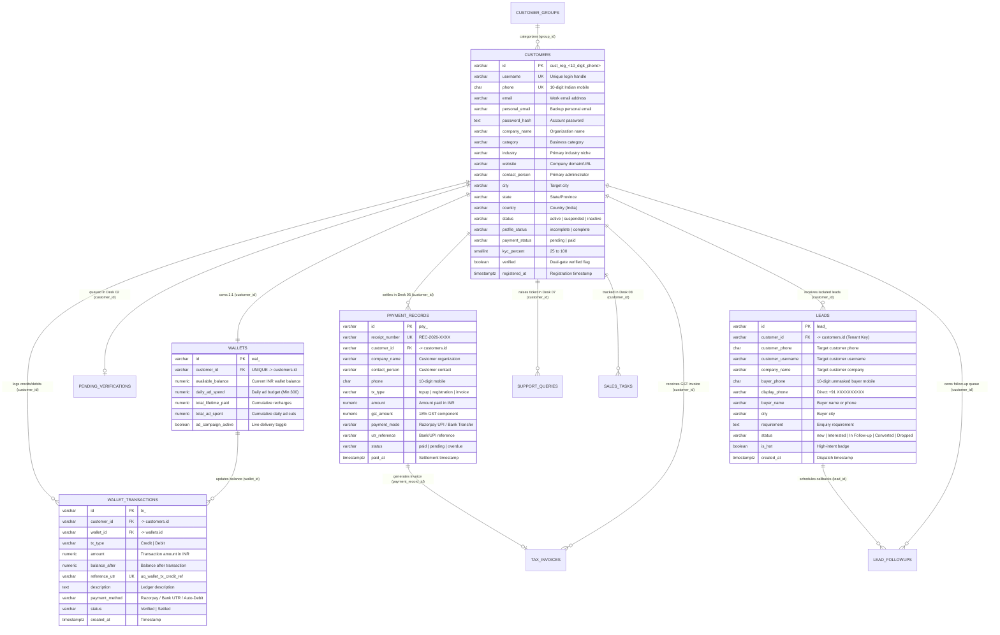

# AdMafia / Growthline CRM — Complete Relational Database Design

This document defines the production relational database architecture for the **AdMafia / Growthline CRM** platform, supporting multi-account customer isolation across the **Customer Portal (`/app/lead`)** and real-time operational aggregation across all **9 Sales Executive & Sub-Admin Desks (`/sales`)**.

---

## 1. Entity-Relationship Diagram (ERD)

---

## 2. Multi-Account Isolation & Sales Desk Mapping

| Table Name | SQL Schema File | LocalStorage Mirror Key | Tenant Isolation Key | Customer Portal View (`/app/lead`) | Sales Portal Desk (`/sales`) |
| :--- | :--- | :--- | :--- | :--- | :--- |
| `customers` | [schema.sql](file:///d:/admafia/database/schema.sql#L25-L65) | `growthline_registered_customers` | `id`, `phone`, `username` | My Profile (`/app/lead#app/profile`) | **Desk 01** (`#customers`) & **Desk 04** (`#profiles`) |
| `wallets` | [schema.sql](file:///d:/admafia/database/schema.sql#L75-L92) | Embedded in `customers` & `growthline_active_user` | `customer_id` | Marketing Wallet (`/app/lead#app/wallet`) | **Desk 06** (`#wallets`) |
| `wallet_transactions` | [schema.sql](file:///d:/admafia/database/schema.sql#L99-L119) | `growthline_wallet_transactions` | `customer_id`, `customerPhone` | Wallet Transactions Tab | Synced with Desk 05 & Desk 06 |
| `payment_records` | [schema.sql](file:///d:/admafia/database/schema.sql#L126-L148) | `growthline_payment_records` | `customer_id`, `phone` | Payment Modal & Wallet Top-Up | **Desk 05** (`#payments`) |
| `tax_invoices` | [schema.sql](file:///d:/admafia/database/schema.sql#L155-L173) | `growthline_wallet_invoices` | `customer_id`, `customerPhone` | GST Tax Invoices Tab | **Desk 05** Receipt Viewer |
| `pending_verifications` | [schema.sql](file:///d:/admafia/database/schema.sql#L180-L201) | `growthline_pending_verifications` | `customer_id`, `phone` | Onboarding Status Banner | **Desk 02** (`#verification`) |
| `leads` | [schema.sql](file:///d:/admafia/database/schema.sql#L208-L239) | `growthline_all_leads` | `customer_id`, `customerPhone`, `company` | Dashboard & Lead Pipeline (`/app/lead#app/lead`) | **Desk 03** (`#leads`) & **Desk 01** (`+ Add Lead`) |
| `lead_followups` | [schema.sql](file:///d:/admafia/database/schema.sql#L246-L262) | Scoped per customer | `customer_id`, `lead_id` | Follow-Ups Queue (`/app/lead#app/follow-ups`) | Customer-internal CRM |
| `support_queries` | [schema.sql](file:///d:/admafia/database/schema.sql#L269-L286) | `growthline_sales_queries` | `customer_id` | Help & Support Modal | **Desk 07** (`#queries`) |
| `sales_tasks` | [schema.sql](file:///d:/admafia/database/schema.sql#L293-L312) | `growthline_sales_tasks` | `customer_id` | N/A (Internal Sales) | **Desk 08** (`#tasks`) |
| `customer_groups` | [schema.sql](file:///d:/admafia/database/schema.sql#L14-L20) | `growthline_customer_groups` | `group_id` | Business Category Selector | **Desk 09** (`#groups`) |

---

## 3. Core Database Integrity & Business Rules

1. **Strict Per-Customer Multi-Tenant Isolation**:
   - When 10 (or 1,000) accounts register at `/#register`, each account receives a unique primary key (`id = cust_reg_<phone>`), unique `username`, and unique 10-digit `phone`.
   - Every lead, wallet transaction, invoice, and payment record carries `customer_id`, `customer_phone`, `customer_username`, and `company_name`.
   - Customer Portal queries filter strictly by `recordBelongsToCustomer(record, activeCustomer)` so Customer A can never see Customer B's leads, wallet balance, transactions, or invoices.
   - Sales Portal (`/sales`) queries aggregate across all registered rows in `customers`, `pending_verifications`, `leads`, and `payment_records` so all 10+ accounts are visible and manageable in one command center.
2. **Duplicate Credit Prevention (`uq_wallet_tx_credit_ref`)**:
   - `wallet_transactions.reference_utr` has a `UNIQUE` constraint so the same Bank UTR or Razorpay Payment Reference can never credit a wallet twice.
3. **Pure Rupee Wallet Balance**:
   - `wallets.available_balance` stores the exact rupee balance (`NUMERIC(12,2)`), and `wallets.daily_ad_spend` stores the daily budget (`Min ₹300/day`) without coupling top-up presets to fixed day packages.
4. **Direct 10-Digit Buyer Phone Storage**:
   - `leads.buyer_phone` enforces `CHECK (buyer_phone ~ '^[6-9][0-9]{9}$')` and `leads.display_phone` stores the unmasked `+91 XXXXXXXXXX` number for immediate one-click Call and WhatsApp actions.

