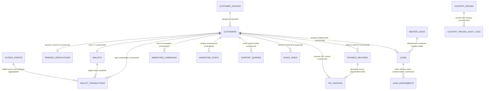

# AdMafia / Growthline CRM — Production MongoDB Database Architecture

This document defines the production MongoDB database architecture for the **AdMafia / Growthline CRM** platform. The system operates on a **MongoDB 7.0 Replica Set (`rs0`)** utilizing **Mongoose ODM**, providing native multi-document ACID transactions, high-concurrency document reads, and the Transactional Outbox pattern for mission-critical lead distribution, wallet accounting, and multi-department operational desks.

---

## 1. High-Level Architecture & Entity Relationships

The database is structured around tenant isolation (each registered business customer owns an isolated slice of leads, wallets, invoices, and campaign settings) coupled with centralized aggregation across all Sales, Marketing, Graphics, and Super Admin desks.

---

## 2. Core Collections & Mongoose Schemas

All models are authored with ES modules in `backend/models/` and registered via Mongoose with production indexing.

### 2.1 Customer & Identity (`backend/models/Customer.js` & `SystemUser.js`)

#### `customers`
Stores registered B2B clients running marketing campaigns and receiving leads.
- **`_id`** (String, PK): Deterministic customer identifier (e.g., `cust_179464...` or `cust_reg_<phone>`).
- **`username`** (String, Unique Index): Unique customer handle for login.
- **`phone`** (String, Unique Index): 10-digit primary mobile number.
- **`email`** (String, Index) & **`personalEmail`** (String).
- **`passwordHash`** (String): Bcrypt or secured credential hash.
- **`companyName`** (String, Required): Legal or trading business name.
- **`category`** (String, Index): Niche/vertical (e.g., *IT & Software*, *Solar*, *Real Estate*).
- **`industry`** (String) & **`website`** (String).
- **`contactPerson`** (String, Required): Authorized representative.
- **`city`**, **`state`**, **`country`**, **`countryCode`**, **`currency`**: Localization settings.
- **`groupId`** (String, Index) & **`groupMemberships`** (Array of `{ groupId, assignedAt }`).
- **`status`** (String, Enum: `active`, `suspended`, `inactive`, Index).
- **`profileStatus`** (String, Enum: `incomplete`, `complete`, Index).
- **`paymentStatus`** (String, Enum: `pending`, `paid`, Index).
- **`kycPercent`** (Number, 0-100, Default: 100).
- **`verified`** (Boolean, Default: true): Dual-gate approval flag.
- **`isSelfRegistered`** (Boolean) & **`registeredFrom`** (String).
- **`statusHistory`** (Array): Audit trail of account status changes.
- **`registeredAt`** (Date, Index) & **`updatedAt`** (Date).
- **Indexes:** `{ phone: 1, status: 1 }`, `{ category: 1, status: 1 }`, `{ registeredAt: -1 }`.

#### `customer_groups`
Classifies businesses into distinct categories and allocation pools.
- **`_id`** (String): Unique group slug (e.g., `grp_real_estate`).
- **`name`** (String, Unique Index): Display title.
- **`category`** (String, Index): Parent category.
- **`icon`** (String): Emoji/icon identifier.
- **`description`** (String).
- **`status`** (String, Enum: `active`, `inactive`).
- **`members`** (Array of Strings): Customer IDs belonging to the group.

#### `system_users`
Role-Based Access Control (RBAC) internal staff accounts.
- **`_id`** (String, PK): Staff identifier.
- **`fullName`** (String, Required).
- **`email`** (String, Unique Index) & **`username`** (String, Unique Index).
- **`phone`** (String, Index).
- **`passwordHash`** (String, Required).
- **`role`** (String, Index): e.g., `superadmin`, `sales`, `support`, `marketing`, `graphics`, `finance`.
- **`department`** (String): Department designation.
- **`permissions`** (Array of Strings): Granular desk capability flags.
- **`status`** (String, Enum: `active`, `inactive`, `suspended`).
- **`lastLoginAt`** (Date).

---

### 2.2 Financial & Wallet Accounting (`backend/models/Finance.js`)

#### `wallets`
The live financial engine powering daily ad pacing and lead delivery.
- **`_id`** (String, PK): Primary wallet ID (`wal_<customerId>`).
- **`customerId`** (String, Unique Index): 1:1 binding to `customers._id`.
- **`availableBalance`** (Number, Min: 0): Current net credit balance in localized currency.
- **`currency`** (String, Default: `'INR'`).
- **`dailyAdSpend`** (Number, Default: 300, Min: 0): Daily ad budget pacing rate.
- **`totalLifetimePaid`** (Number): Cumulative top-ups and wallet credits.
- **`totalAdSpent`** (Number): Cumulative ad spend debits.
- **`adCampaignActive`** (Boolean, Index): Live campaign switch.
- **`activeDays`** (Array of Strings): Target active schedule (e.g., `['MON', 'TUE', 'WED', 'THU', 'FRI']`).
- **`schedulePreset`** (String, Default: `'custom'`).
- **`bookedDates`** (Array of Strings): Historical days on which ad budget was locked/deducted.
- **`lastDeductedAt`** (Date): Timestamp of most recent daily budget deduction.

#### `wallet_transactions`
Append-only immutable financial ledger ensuring strict auditability.
- **`_id`** (String, PK): Transaction ID (`tx_<timestamp>_<random>`).
- **`customerId`** (String, Index): Target account.
- **`walletId`** (String, Index): Reference wallet.
- **`txType`** (String, Enum: `['Credit', 'Debit']`, Index).
- **`amount`** (Number, Required, Min: 0).
- **`balanceAfter`** (Number, Required): Post-transaction balance snapshot.
- **`referenceUtr`** (String, Unique Sparse Index): Bank settlement UTR or Razorpay Payment ID. Prevents double-credit.
- **`description`** (String, Required): Ledger explanation.
- **`paymentMethod`** (String): e.g., `'Razorpay Secure (UPI/Card)'`, `'Bank NEFT/RTGS'`, `'Daily Ad Spend Deduction'`.
- **`status`** (String, Default: `'Verified ✓'`).
- **`currency`** (String, Default: `'INR'`).
- **`createdAt`** (Date, Index): Immutable creation timestamp.
- **Indexes:** `{ referenceUtr: 1 }` (unique, sparse), `{ customerId: 1, txType: 1 }`, `{ createdAt: -1 }`.

#### `payment_records`
Bank and online gateway settlement records reviewed in Sales Desk 05.
- **`_id`** (String, PK): Payment record ID.
- **`customerId`** (String, Index).
- **`walletId`** (String).
- **`amount`** (Number, Required).
- **`currency`** (String, Default: `'INR'`).
- **`paymentMethod`** (String, Default: `'Razorpay'`).
- **`gatewayOrderId`**, **`gatewayPaymentId`**, **`gatewaySignature`**: Razorpay metadata.
- **`referenceUtr`** (String, Index): Bank UTR reference.
- **`receiptNumber`** (String): Commercial receipt tracking number (`REC-2026-XXXX`).
- **`companyName`**, **`contactPerson`**, **`phone`**, **`city`**: Denormalized customer metadata for fast desk listing.
- **`gstAmount`** (Number): 18% GST component.
- **`totalAmount`** (Number): Total paid gross.
- **`status`** (String, Index): `'Verified ✓'`, `'pending'`, `'overdue'`.

#### `tax_invoices`
Formal GST tax invoices generated automatically upon wallet credit.
- **`_id`** (String, PK): Invoice ID.
- **`customerId`** (String, Index).
- **`paymentRecordId`** (String, Index).
- **`invoiceNumber`** (String, Unique Index): Fiscal invoice reference (`INV-2026-XXXX`).
- **`particulars`** (String): Service description.
- **`sacCode`** (String, Default: `'998311'`): Service Accounting Code for digital advertising.
- **`baseAmount`**, **`cgstAmount`** (9%), **`sgstAmount`** (9%), **`igstAmount`** (18%), **`totalAmount`**.
- **`status`** (String, Default: `'Paid'`).
- **`pdfUrl`** (String).

---

### 2.3 Lead Generation & Ingestion Engine (`backend/models/Leads.js`)

#### `master_leads`
The master intake pool of inbound buyer enquiries captured from Meta Lead Ads, Google Forms, or Webhooks.
- **`_id`** (String, PK).
- **`leadNumber`** (String, Unique Index): Sequential/slug reference (`ML-XXXX`).
- **`fullName`** (String, Required).
- **`phone`** (String, Index): 10-digit unmasked buyer phone number.
- **`email`**, **`category`** (Index), **`subCategory`**, **`city`**, **`state`**, **`country`**.
- **`source`** (String, Default: `'Meta Ads'`).
- **`requirement`** (String) & **`budget`** (String).
- **`status`** (String, Index): `'Unassigned'`, `'Dispatched'`, `'Completed'`.
- **`totalDispatched`** (Number, Default: 0): How many client accounts have received this lead.

#### `leads`
Tenant-isolated leads dispatched to a specific customer account.
- **`_id`** (String, PK): Lead ID.
- **`masterLeadId`** (String, Index): Link back to source master lead.
- **`customerId`** (String, Index): Tenant isolation key.
- **`fullName`** (String, Required).
- **`phone`** (String, Required): Direct buyer mobile number.
- **`displayPhone`** (String): Pre-formatted `+91 XXXXXXXXXX` for one-click Call and WhatsApp.
- **`category`** (String, Index).
- **`city`**, **`state`**.
- **`status`** (String, Index): Pipeline stage (`new`, `Contacted`, `Interested`, `Callback`, `Converted`, `Dropped`).
- **`isRead`** (Boolean, Default: false, Index): Unread badge trigger in Customer Portal.
- **`isHot`** (Boolean, Default: true): High-intent flag.
- **`assignedAt`** (Date, Index).
- **`followups`** (Array): Embedded interaction logs (`note`, `stage`, `createdBy`, `createdAt`).
- **Indexes:** `{ customerId: 1, status: 1 }`, `{ customerId: 1, masterLeadId: 1 }`, `{ assignedAt: -1 }`.

#### `lead_assignments`
Immutable distribution log tracking the algorithmic dispatch of master leads to active paying customers.

---

### 2.4 Marketing Campaigns, Creative Desks & Outbox (`backend/models/`)

#### `marketing_campaigns` (`CampaignsAndPricing.js`)
- Records customer ad campaigns, objective (`lead_generation`), target audience, daily pacing, and external platform connection state.

#### `marketing_posts` & `marketing_ideas` (`MarketingPost.js`, `MarketingIdea.js`)
- Powers the **Graphics Desk (`/graphics`)** and **Marketing Operations Desk (`/marketing`)**.
- Supports creative post uploading, multi-stage supervisor reviews (Pending Review -> Approved / Rejected), revision comments, and scheduling.

#### `country_pricing` & `country_pricing_audit_logs` (`CampaignsAndPricing.js`)
- Authoritative multi-currency localization rules (e.g., `IN` = INR ₹300/day, `AE` = AED 15/day, `US` = USD $5/day).
- Enforces minimum wallet top-ups, tax rates, phone codes, and currency formatting.
- Changes made in SuperAdmin Desk are tracked in `country_pricing_audit_logs`.

#### `outbox_events` (`CampaignsAndPricing.js`)
- Implements the **Transactional Outbox Pattern**.
- Stores async events created atomically inside the same MongoDB session as business mutations.
- Monitored by `services/outboxWorker.js` to dispatch webhooks, notifications, or external platform syncs with zero message loss.

---

## 3. Multi-Tenant Isolation & Desk Access Architecture

Every business client accessing `/portal` (`/app/lead`) operates within a strictly isolated sandbox enforced at both the API and database levels:

| Business Entity | MongoDB Collection | Tenant Isolation Key | Customer Portal View (`/portal`) | Sales / Admin Portal Desk (`/sales`) |
| :--- | :--- | :--- | :--- | :--- |
| **Customer Profile** | `customers` | `_id`, `phone`, `username` | My Profile (`/portal#app/profile`) | **Desk 01** (`#customers`) & **Desk 04** (`#profiles`) |
| **Marketing Wallet** | `wallets` | `customerId` | Marketing Wallet (`/portal#app/wallet`) | **Desk 06** (`#wallets`) & SuperAdmin Finance |
| **Wallet Ledger** | `wallet_transactions` | `customerId` | Transaction History Tab | Synced in Desk 05, Desk 06 & SuperAdmin |
| **Payment Receipts** | `payment_records` | `customerId`, `phone` | Top-Up History Modal | **Desk 05** (`#payments`) & SuperAdmin Finance |
| **GST Tax Invoices** | `tax_invoices` | `customerId` | GST Tax Invoices Tab | **Desk 05** Receipt / Invoice Viewer |
| **Intake Queue** | `pending_verifications`| `customerId`, `phone` | Onboarding Status Banner | **Desk 02** (`#verification`) |
| **Buyer Leads** | `leads` | `customerId` | Lead Pipeline (`/portal#app/lead`) | **Desk 03** (`#leads`) & Master Lead Dispatch |
| **Follow-Ups** | `leads.followups` | Scoped within customer lead | Follow-Ups Queue (`/portal#app/follow-ups`)| Internal Customer Pipeline |
| **Marketing Posts** | `marketing_posts` | `customerId` | Creative Assets Tab | **Graphics Desk** (`/graphics`) & Marketing |
| **Support Tickets** | `support_queries` | `customerId` | Help & Support Modal | **Desk 07** (`#queries`) |
| **Internal Tasks** | `sales_tasks` | `customerId` | N/A (Internal Staff Only) | **Desk 08** (`#tasks`) |
| **Customer Groups** | `customer_groups` | `groupId` / `members` | Category Selector | **Desk 09** (`#groups`) |

---

## 4. Database Integrity, Concurrency & High-Availability Rules

1. **Native MongoDB ACID Multi-Document Transactions (`backend/repositories/tx.js`)**:
   - Financial ledger entries, wallet balance increments/deductions, and lead allocations run within `withTransaction(async (session) => { ... })`.
   - If any step fails (e.g., duplicate UTR, negative balance violation, or allocation constraint), the entire session rolls back cleanly.

2. **Idempotency & Duplicate Credit Prevention (`referenceUtr`)**:
   - `wallet_transactions` enforces a `{ unique: true, sparse: true }` index on `referenceUtr`.
   - Any retry, concurrent payment webhook, or duplicate form submission for the same Bank UTR or Razorpay Payment ID is rejected with duplicate key error `E11000`.

3. **Pure Rupee & Currency Precision**:
   - `wallets.availableBalance` and `wallet_transactions.amount` store exact currency amounts.
   - Pacing logic (`wallets.dailyAdSpend`) enforces minimum daily budget constraints configured dynamically in `country_pricing`.

4. **10-Digit Direct Phone Number Integrity**:
   - Customer phone numbers (`customers.phone`) and buyer contact numbers (`leads.phone`) are stored as clean 10-digit strings.
   - `leads.displayPhone` stores the international format `+91 XXXXXXXXXX` for seamless one-click calling (`tel:`) and WhatsApp messaging (`https://api.whatsapp.com/send?phone=...`).

5. **Automated Bootstrap & Seeding (`backend/repositories/bootstrapRepo.js`)**:
   - On server startup, `initMongo()` connects to MongoDB 7.0 Replica Set.
   - `bootstrapRepo.js` automatically creates missing collections, establishes indexes, and seeds initial Super Admin accounts, department staff, and default country pricing without requiring manual SQL migration scripts.
