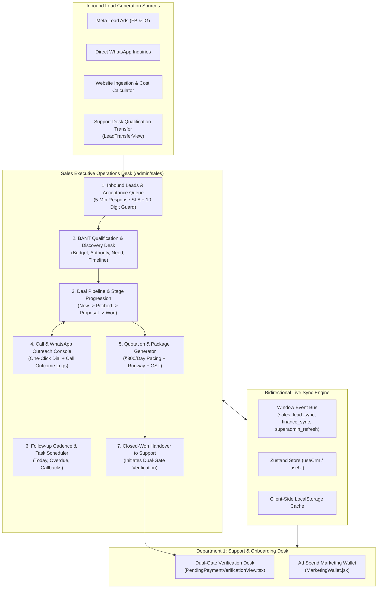
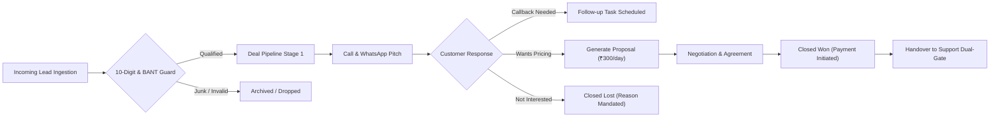
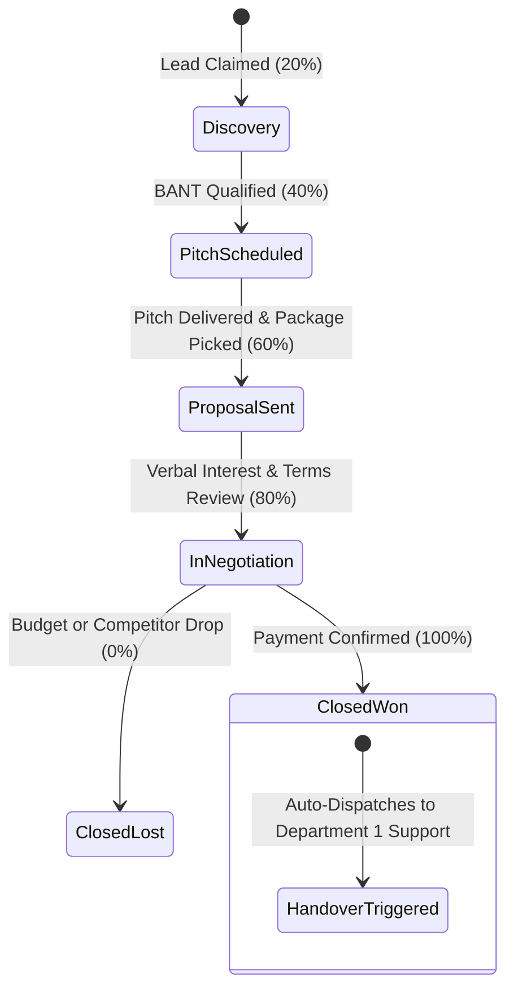
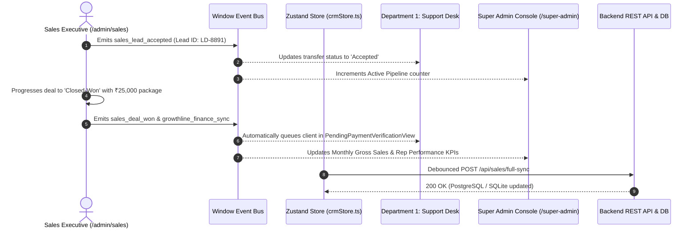

# Growthline CRM — Sales Executive Operations Manual & Architecture Guide

## 1. Executive Summary & Purpose

The **Sales Executive Module** (accessible via `/admin/sales` and `/sales/*`) operates as the primary revenue-generation engine of Growthline CRM. While the **Super Admin** console governs executive business intelligence, commission structures, and platform policies, and the **Sub Admin / Support Desk** manages onboarding KYC and technical operations, the **Sales Executive Desk** drives:
- Rapid response to inbound qualified leads (Meta Lead Ads, WhatsApp inquiries, web forms)
- Acceptance and processing of qualified transfers from the Support Desk
- Multi-channel outreach (direct phone calls, pre-filled WhatsApp templates, email briefs)
- Deal stage progression from first touch to verbal close
- Proposal and quotation generation with dynamic ad runway calculations (₹300/day minimum ad burn)
- Sales follow-up cadences, meeting scheduling, and call outcome logging
- Structured handover to Department 1 (Support / Dual-Gate Verification) upon deal closure



---

## 2. Role Boundaries: Sales Executive vs. Support vs. Super Admin

| Operational Dimension | Sales Executive (`/admin/sales`) | Sub Admin / Support (`/admin/support`) | Super Admin (`/super-admin/*`) |
| :--- | :--- | :--- | :--- |
| **Primary Objective** | Lead conversion, deal velocity, quota achievement, customer acquisition | Dual-Gate KYC verification, UTR audit, wallet funding, support tickets | Executive BI, margin analysis, global team quotas, commission payouts |
| **Lead Handling** | Claims unassigned leads, accepts Support transfers, executes discovery calls | Ingests raw leads, sanitizes phone numbers, routes category broadcasts | Ingests bulk enterprise lists, configures routing algorithms |
| **Deal Pipeline** | Owns deal stages (Discovery, Pitch, Proposal, Negotiation, Closed-Won) | Views customer account status, monitors onboarding readiness | Tracks aggregate pipeline value, conversion velocity, win/loss ratios |
| **Quotations & Pricing** | Builds standard campaign packages (₹300/day minimum, ₹10k/₹25k presets) | Audits bank payment receipts and verified UTR references | Authorizes custom agency pricing, enterprise discounts, and credit terms |
| **Customer Interaction** | Pre-sale consultation, competitive positioning, value proposition pitches | Post-sale onboarding, KYC chasing, technical query resolution | Escalated account disputes, executive relationship reviews |
| **Wallet Management** | Configures proposed ad budget and calculates projected runway days | Audits daily ₹300/day deductions, confirms top-ups upon verified bank UTR | Authorizes balance adjustments, manual debits, or refund disbursements |
| **Commission & Targets** | Tracks individual closed revenue, target pacing, and monthly incentives | Zero commission linkage; evaluated on ticket resolution SLAs and KYC speed | Sets rep quotas, approves sales incentives, audits company-wide margins |

---

## 3. Route Map & Navigation Architecture

The Sales Executive module integrates into the unified Growthline CRM architecture with dedicated endpoints:

| Route Path | Default View | Primary Component | Operational Purpose |
| :--- | :--- | :--- | :--- |
| `http://localhost:5173/admin/sales` | `leads` | [LeadManagementView.tsx](file:///d:/crm/frontend/src/features/support/LeadManagementView.tsx) | Live incoming leads, fast qualification, and status toggles |
| `http://localhost:5173/admin/sales/transfers` | `transfers` | [LeadTransferView.tsx](file:///d:/crm/frontend/src/features/support/LeadTransferView.tsx) | Review and accept qualified handover records from Support |
| `http://localhost:5173/admin/sales/pipeline` | `pipeline` | `SalesDealPipelineView.tsx` | Kanban visual board for deal stages from Discovery to Won |
| `http://localhost:5173/admin/sales/quotes` | `proposals` | `SalesProposalGeneratorView.tsx` | Proposal creator with ₹300/day pacing and GST breakdown |
| `http://localhost:5173/admin/sales/tasks` | `tasks` | [FollowupTaskView.tsx](file:///d:/crm/frontend/src/features/support/FollowupTaskView.tsx) | Daily callback scheduler, touchpoints, and call logs |
| `http://localhost:5173/admin/sales/metrics` | `performance` | `SalesPerformanceAnalyticsView.tsx` | Individual quota progress, conversion %, and revenue closed |

---

## 4. Deep-Dive: The 7 Operational Sales Desks



---

### 4.1 Inbound Leads & Acceptance Queue Desk
- **Components**: [LeadManagementView.tsx](file:///d:/crm/frontend/src/features/support/LeadManagementView.tsx) and [LeadTransferView.tsx](file:///d:/crm/frontend/src/features/support/LeadTransferView.tsx)
- **Primary Data Model**: `SupportLead` & `LeadTransferRecord`

#### Core Capabilities:
1. **Speed-to-Lead Response SLA**: Incoming leads trigger an amber/gold indicator requiring outreach within **5 minutes** of ingestion.
2. **Support Handover Acceptance Funnel**:
   - When Support qualifies an inbound lead via `LeadTransferView.tsx`, it enters the queue as `pending_acceptance`.
   - The assigned Sales Executive reviews the handover brief, qualification notes, and client budget.
   - Action buttons: **✓ Accept Lead** (claims ownership and moves to active pipeline) or **✕ Decline with Reason** (returns to Support pool).
3. **10-Digit Mobile Number Validation & Sanitization**:
   - Strictly enforced via `sanitizePhone10` and `validatePhoneNumber`.
   - Strips `+91`, leading zeros, spaces, and hyphens.
   - Enforces exactly 10 digits starting with `6`, `7`, `8`, or `9`.

---

### 4.2 BANT Qualification & Discovery Desk
- **Component**: `SalesDiscoveryModal.tsx` / [LeadManagementView.tsx](file:///d:/crm/frontend/src/features/support/LeadManagementView.tsx)

Every claimed lead undergoes systematic **BANT Qualification** before being moved deeper into the pipeline:

| Qualification Pillar | Evaluation Criteria | Minimum Acceptable Threshold |
| :--- | :--- | :--- |
| **Budget (B)** | Does the client have capital for online ads? | Minimum ₹300/day active ad burn + ₹10,000 onboarding package |
| **Authority (A)** | Is the contact person the business owner/decision maker? | Proprietor, Director, Partner, or authorized Marketing Head |
| **Need (N)** | Does the business require buyer customer inquiries? | Clear service/product category, target territory, active capacity |
| **Timeline (T)** | When does the client intend to launch advertising? | Within 7 to 14 calendar days |

---

### 4.3 Deal Pipeline & Stage Progression Desk
- **Component**: `SalesDealPipelineView.tsx`
- **Visual Design**: 5-column Kanban board with real-time drag-and-drop and stage probability weighting.



#### Stage Progression Matrix:
1. **Stage 1: Discovery / New Lead (Probability: 20%)**: Initial contact initiated; verifying requirements and territory eligibility.
2. **Stage 2: Pitch & Demo Scheduled (Probability: 40%)**: Live walkthrough of Growthline lead generation engine and territory exclusivity.
3. **Stage 3: Proposal Delivered (Probability: 60%)**: Formal commercial quotation dispatched with calculated runway days.
4. **Stage 4: In Negotiation / Verbal Close (Probability: 80%)**: Agreement on budget, invoice issuance, awaiting bank transfer / gateway clearance.
5. **Stage 5: Closed-Won (Probability: 100%)**: Client paid onboarding deposit; account transferred to Support for KYC.
6. **Closed-Lost (Probability: 0%)**: Lead dropped with required reason tag (`Budget Constraint`, `Out of Service Area`, `Selected Competitor`, `Non-Responsive`).

---

### 4.4 Multi-Channel Outreach & Call Logging Desk
- **Component**: [LeadManagementView.tsx](file:///d:/crm/frontend/src/features/support/LeadManagementView.tsx)
- **Primary Model**: `CallLogEntry`

#### Instant Communication Triggers:
- **One-Click Native Calling**: Clickable `tel:+91XXXXXXXXXX` links allowing immediate connection via softphone or mobile.
- **Pre-Formatted WhatsApp Outreach**:
  - Automatically constructs encoded WhatsApp Web / API links:
    ```text
    https://wa.me/919811044598?text=Hello%20Rajesh%20Mehta,%20thank%20you%20for%20your%20inquiry%20with%20Growthline%20CRM.%20I%20am%20calling%20regarding%20your%20Meta%20Ads%20lead%20generation%20campaign.
    ```
- **Call Disposition Logging Modal**:
  - Fields: Interaction Timestamp, Call Duration (`03m 45s`), Call Outcome (`Connected - Pitch Made`, `Busy / Callback Requested`, `Wrong Number`, `Not Interested`), Follow-up Date/Time, and Free-Form Notes.

---

### 4.5 Proposal & Quotation Generator Desk
- **Component**: `SalesProposalGeneratorView.tsx`
- **Core Concept**: Transparent ad-spend runtime calculation.

Growthline packages are structured around transparent advertising runtimes calculated against the fixed **₹300/day** campaign burn rate:

$$\text{Funded Campaign Runway Days} = \left\lfloor \frac{\text{Net Ad Budget}}{\text{Daily Burn Rate (₹300/day)}} \right\rfloor$$

#### Standard Commercial Packages:

| Package Tier | Total Budget | Setup / Onboarding Fee | Net Ad Credit | Funded Runway Days | Target Territory |
| :--- | :--- | :--- | :--- | :--- | :--- |
| **Starter Runway** | ₹10,000 + 18% GST | ₹2,500 | ₹7,500 | **25 Active Days** | Single City / Local District |
| **Growth Booster** | ₹25,000 + 18% GST | ₹4,000 | ₹21,000 | **70 Active Days** | Multi-City / State Tier 1 |
| **Scale Enterprise** | ₹50,000 + 18% GST | ₹5,000 | ₹45,000 | **150 Active Days** | Pan-India / Multiple Categories |

#### Features:
- Instant PDF quotation generation with official GST tax breakdown (CGST 9% + SGST 9% or IGST 18%).
- Generates official online payment link via Razorpay or displays Company Bank RTGS/NEFT coordinates.

---

### 4.6 Follow-up Cadence & Task Scheduler Desk
- **Component**: [FollowupTaskView.tsx](file:///d:/crm/frontend/src/features/support/FollowupTaskView.tsx)
- **Purpose**: Prevents lead leakage and guarantees disciplined follow-up cadences.

#### Recommended 7-Day Outreach Cadence:
- **Day 1 (0 Hours)**: Inbound inquiry received -> Initial phone call within 5 mins + immediate WhatsApp introduction.
- **Day 2 (+24 Hours)**: Follow-up WhatsApp with service portfolio & territory client case study.
- **Day 3 (+48 Hours)**: Secondary call attempt at alternate time (morning vs. afternoon).
- **Day 5 (+96 Hours)**: Value-add touchpoint with competitive lead benchmark in the client's industry.
- **Day 7 (+168 Hours)**: Final closing outreach ("Closing File" message) prompting decision.

---

### 4.7 Closed-Won Handover to Support Desk
- **Component**: `SalesToSupportHandoverModal.tsx`

When a client accepts a commercial proposal and executes the initial payment:
1. The Sales Executive changes the deal status to **Closed-Won**.
2. Enters the payment mode (Online Gateway / Direct Bank UTR).
3. Attaches client campaign preferences:
   - Primary category & sub-services
   - Preferred daily ad burn rate (₹300, ₹600, or ₹1,000/day)
   - Excluded localities / targeted pin codes
4. Clicks **Handover to Operations**.
5. The system immediately creates a record in Department 1's **Pending Verification Desk** ([PendingPaymentVerificationView.tsx](file:///d:/crm/frontend/src/features/support/PendingPaymentVerificationView.tsx)) under the `Payment Pending` queue.

---

## 5. Bidirectional Live Synchronization Engine

The Sales Executive module communicates seamlessly with the Super Admin Console and Department 1 Support Desk via the window event bus:



### Event Bus Directory:
1. **`sales_lead_transfer_accepted`**: Fired when a rep accepts a handover from Support.
2. **`sales_deal_stage_changed`**: Updates the Super Admin pipeline overview counters in real time.
3. **`growthline_finance_sync`**: Fired when a deposit is reported, alerting the billing desk.
4. **`superadmin_refresh`**: Forces executive analytics to re-pull conversion benchmarks.

---

## 6. Backend API & Database Schema Reference

### 6.1 Sales Controller Endpoints (`/api/sales/*`)

| HTTP Method | Route Endpoint | Payload / Query | Response Structure | Operational Purpose |
| :--- | :--- | :--- | :--- | :--- |
| `GET` | `/api/sales/pipeline` | `?repId=<id>&period=month` | `{ totals, stages, deals: Deal[] }` | Retrieve Kanban pipeline deals for assigned rep |
| `POST` | `/api/sales/deals` | `{ leadId, customerName, budget, stage }` | `{ success: true, data: Deal }` | Create a new active sales opportunity |
| `PUT` | `/api/sales/deals/:id/stage` | `{ stage, lostReason, probability }` | `{ success: true, data: Deal }` | Advance deal stage or log closed-lost |
| `POST` | `/api/sales/calls` | `{ dealId, leadId, duration, outcome, notes }` | `{ success: true, data: CallLog }` | Log customer call outcome |
| `POST` | `/api/sales/proposals` | `{ dealId, packageTier, dailySpend, gstNumber }` | `{ success: true, proposalUrl, quoteId }` | Generate and issue commercial proposal |
| `GET` | `/api/sales/performance` | `?repId=<id>` | `{ quota, revenueClosed, winRate, rank }` | Rep monthly scorecard and quota progress |

### 6.2 Database Schema: `sales_deals` & `sales_call_logs`

```sql
-- Sales Deals & Pipeline Table
CREATE TABLE IF NOT EXISTS sales_deals (
  id VARCHAR(100) PRIMARY KEY,
  lead_id VARCHAR(100) NOT NULL REFERENCES leads(id) ON DELETE CASCADE,
  customer_id VARCHAR(100) REFERENCES customers(id) ON DELETE SET NULL,
  rep_id VARCHAR(100) NOT NULL,
  deal_title VARCHAR(255) NOT NULL,
  stage VARCHAR(50) NOT NULL DEFAULT 'discovery',
  package_tier VARCHAR(100) NOT NULL DEFAULT 'Starter Runway',
  daily_ad_spend NUMERIC(10, 2) NOT NULL DEFAULT 300.00,
  total_deal_value NUMERIC(12, 2) NOT NULL DEFAULT 10000.00,
  probability_pct INTEGER NOT NULL DEFAULT 20,
  expected_close_date DATE,
  lost_reason VARCHAR(255),
  created_at TIMESTAMPTZ NOT NULL DEFAULT CURRENT_TIMESTAMP,
  closed_at TIMESTAMPTZ
);

-- Call Logs Table
CREATE TABLE IF NOT EXISTS sales_call_logs (
  id VARCHAR(100) PRIMARY KEY,
  deal_id VARCHAR(100) REFERENCES sales_deals(id) ON DELETE CASCADE,
  lead_id VARCHAR(100) NOT NULL REFERENCES leads(id) ON DELETE CASCADE,
  rep_id VARCHAR(100) NOT NULL,
  duration_seconds INTEGER NOT NULL DEFAULT 0,
  outcome VARCHAR(100) NOT NULL,
  notes TEXT,
  scheduled_callback TIMESTAMPTZ,
  created_at TIMESTAMPTZ NOT NULL DEFAULT CURRENT_TIMESTAMP
);

CREATE INDEX IF NOT EXISTS idx_sales_deals_rep ON sales_deals(rep_id);
CREATE INDEX IF NOT EXISTS idx_sales_deals_stage ON sales_deals(stage);
CREATE INDEX IF NOT EXISTS idx_sales_calls_deal ON sales_call_logs(deal_id);
```

---

## 7. Standard Operating Procedures (SOPs) for Sales Executives

### SOP 1: Inbound Lead Acceptance & 5-Minute Contact Rule
1. Open the Sales Desk (`/admin/sales`).
2. Filter for `New Leads` or check the `Support Handover` tab.
3. Review the company requirement, city territory, and contact details.
4. Click **✓ Accept Handover** to assign the record to your personal queue.
5. Immediately click the **Call** link (`tel:`) to initiate outreach within 5 minutes of receipt.
6. If the client does not answer, send the pre-formatted WhatsApp introduction template and schedule a callback for the afternoon.

### SOP 2: Conducting the Discovery Call & BANT Qualification
1. Greet the business owner and confirm their primary inquiry requirement.
2. Verify their target locality / city and inquire about monthly capacity.
3. Explain Growthline's dedicated Meta Lead Generation workflow and daily auto-cut pacing model (₹300/day).
4. Open the **Call Disposition** modal:
   - Record call duration (e.g. `05m 12s`).
   - Tag outcome: `Interested - Proposal Requested`.
   - Set follow-up date and time.
5. Move the deal to **Stage 2: Pitch & Demo Completed** or **Stage 3: Proposal Sent**.

### SOP 3: Generating and Delivering a Quotation
1. Navigate to the **Proposal Builder** tab.
2. Select the client deal and choose the package tier (e.g. `Growth Booster - ₹25,000`).
3. Set the daily ad spend rate (Default: ₹300/day).
4. Confirm company billing details and GSTIN (if applicable).
5. Click **Generate Official Proposal**.
6. Dispatch the proposal link and payment instructions via WhatsApp and Email.

### SOP 4: Closing the Sale & Executing Support Desk Handover
1. Once the client confirms payment via Bank UTR or Razorpay Gateway:
2. Drag the deal card to **Closed-Won (100%)**.
3. In the handover confirmation prompt, enter the payment settlement reference.
4. Add campaign setup notes (target keywords, preferred ad creative angles, territory exclusions).
5. Click **Confirm Handover to Support**.
6. The client is immediately queued in Department 1's Dual-Gate Verification Desk for onboarding clearance.

---

## 8. Verification & Quick Troubleshooting

### Health Check Commands
```bash
# 1. Verify frontend TypeScript typing and component contracts
cd d:/crm/frontend && npx tsc --noEmit

# 2. Verify backend TypeScript compilation
cd d:/crm/backend && npx tsc --noEmit

# 3. Test backend sales REST endpoints
curl http://localhost:3001/api/sales/pipeline
curl http://localhost:3001/api/sales/performance
```

### Common Issues & Troubleshooting

| Symptom | Probable Cause | Corrective Action |
| :--- | :--- | :--- |
| **"Cannot accept lead handover"** | Transfer record already claimed by another executive or expired | Refresh desk to pull active transfer pool state; check [LeadTransferView.tsx](file:///d:/crm/frontend/src/features/support/LeadTransferView.tsx). |
| **Phone number input rejected** | Input contains special characters, spaces, or non-Indian prefix | Ensure the number has exactly 10 digits starting with 6-9; `sanitizePhone10` automatically cleans valid digits. |
| **Proposal runtime calculation mismatch** | Daily burn rate modified from standard ₹300/day | Verify budget divided by daily rate: $\lfloor \text{Net Ad Budget} / \text{Rate} \rfloor$. |
| **Closed-Won deal not showing in Support Desk** | `growthline_finance_sync` or `sales_deal_won` event unbroadcast | Check browser developer console for event bus firing; verify backend sync status. |
