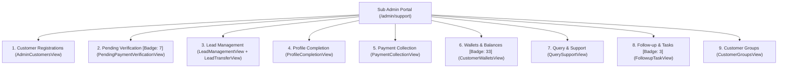
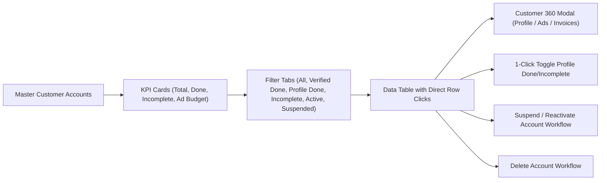
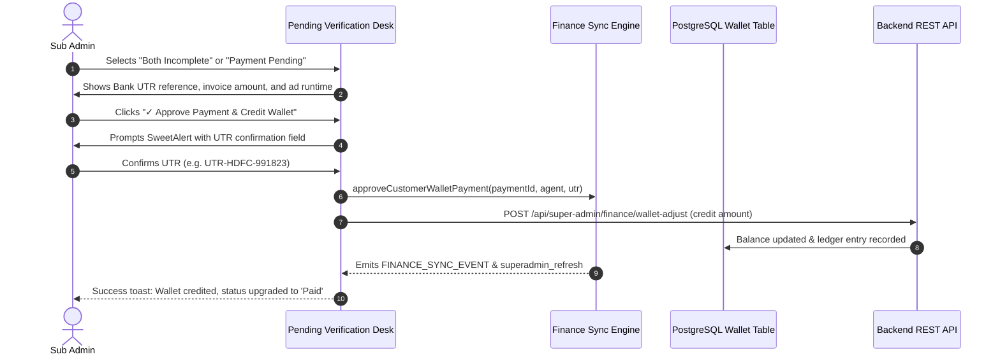
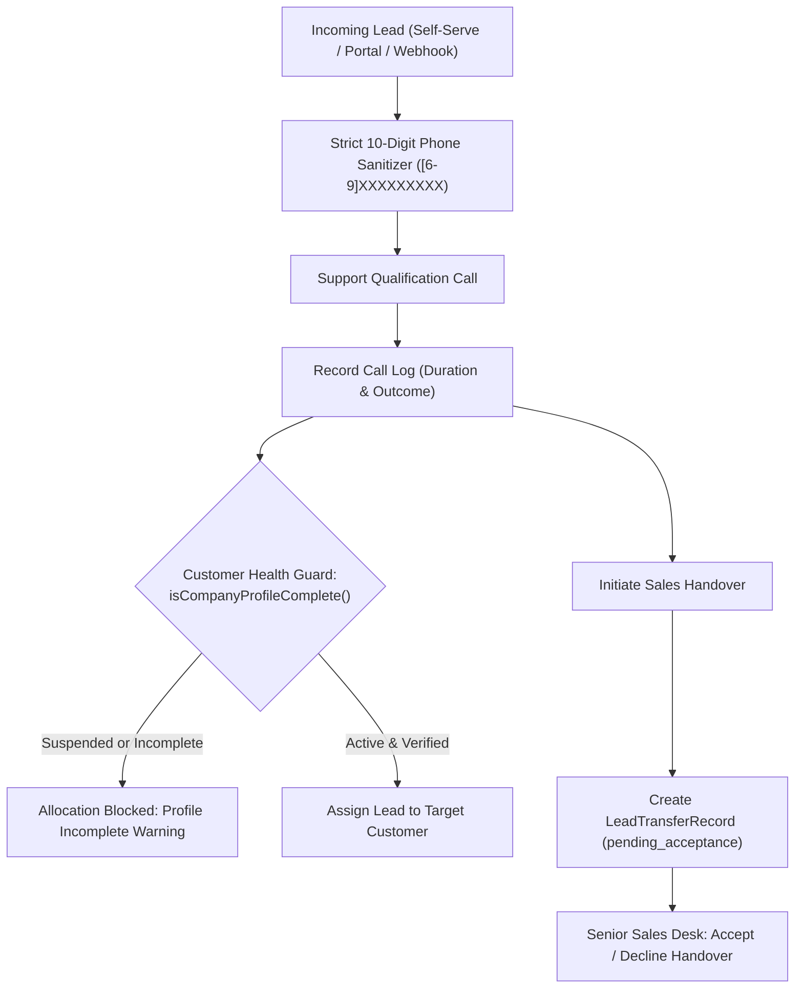
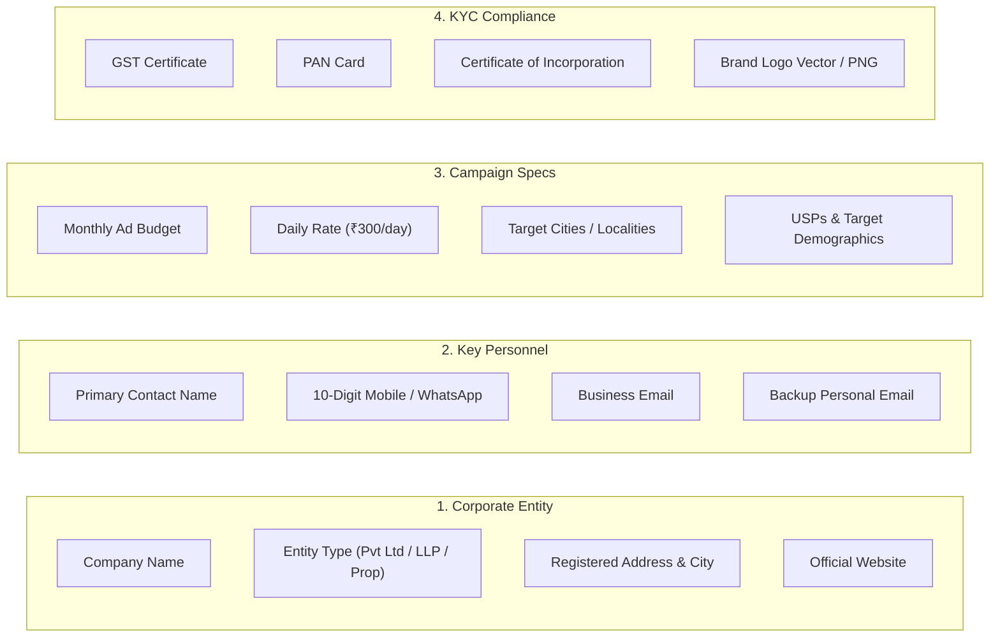
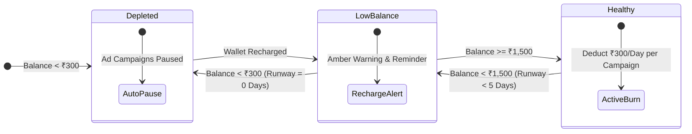
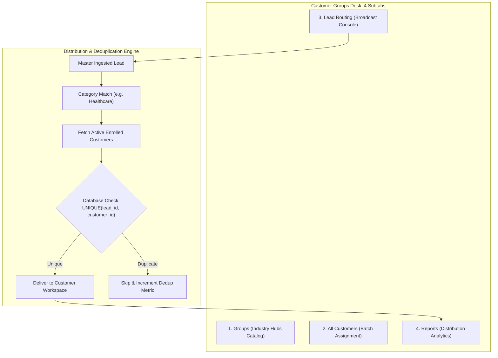
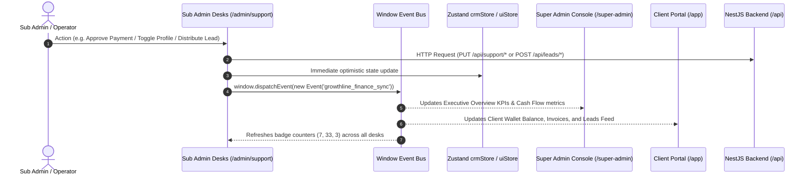

# Growthline CRM — Sub Admin & Operations Desks Complete Reference Manual

This manual provides an exhaustive, screen-by-screen, and field-by-field reference for all **9 Operational Desks** in the **Sub Admin / Support & Sales Module** (`/admin/support` and `/admin/*`).

---

## 🧭 Navigation & Sidebar Architecture

The Sub Admin panel is driven by [SubAdminSupportPanel.tsx](file:///d:/crm/frontend/src/features/support/SubAdminSupportPanel.tsx) with a responsive desktop sidebar and mobile overlay drawer.



### Dynamic Sidebar Badge Calculations

| Sidebar Nav Item | Tab Key | Route | Badge Logic & Dynamic Counter | Badge Color Class |
| :--- | :--- | :--- | :--- | :--- |
| **Customer Registrations** | `customers` | `/admin/customers` | Count of registered / self-registered client workspaces (`isSelfRegistered \|\| username`). | `indigo` |
| **Pending Verification** | `pending_verification` | `/admin/verification` | **`7`** — Accounts requiring verification: `!isPaid \|\| !isComplete`. | `alert` (Amber / Red pulse) |
| **Lead Management** | `leads` | `/admin/sales` | Count of urgent leads (`requiresImmediateAttention \|\| status === 'urgent'`). | `alert` |
| **Profile Completion** | `profiles` | `/admin/profiles` | Count of incomplete onboarding profiles (`!isComplete`). | `warn` |
| **Payment Collection** | `payments` | `/admin/payments` | Count of overdue invoices (`status === 'overdue'`). | `alert` |
| **Wallets & Balances** | `wallets` | `/admin/wallets` | **`33`** — Total enrolled client billing accounts (`crmData.customers.length`). | `indigo` |
| **Query & Support** | `queries` | `/admin/queries` | Count of unresolved tickets (`status === 'open' \|\| status === 'in_progress'`). | `indigo` |
| **Follow-up & Tasks** | `tasks` | `/admin/tasks` | **`3`** — Non-completed tasks scheduled for today (`dueStatus === 'today' && status !== 'Completed'`). | `success` (Green) |
| **Customer Groups** | `groups` | `/admin/groups` | Total registered industry groups from database (`customerGroupsCount`). | `indigo` |

---

## 1. Customer Registrations Desk

- **Route:** `http://localhost:5173/admin/customers` or `http://localhost:5173/admin`
- **Component:** [AdminCustomersView.tsx](file:///d:/crm/frontend/src/features/support/AdminCustomersView.tsx)
- **Header Description:** *"Customer Accounts & Registrations — Verified client workspaces, organization profiles, and ad budgets matching `/get-started`"*



### 1.1 KPI Summary Cards

1. **Customer Accounts (Teal, `#0d9488`):**
   - **Metric:** Total customer accounts registered (`allCustomerAccounts.length`).
   - **Subtitle:** *"Total active client accounts"*.
   - **Click Action:** Resets filter to `all`.
2. **100% Profile Done (Emerald, `#16a34a`):**
   - **Metric:** Verified accounts with completed KYC and step setup (`c.isComplete === true`).
   - **Subtitle:** *"Step 1 & Step 2 complete"*.
   - **Click Action:** Toggles filter to `profile_done`.
3. **Profile Incomplete (Orange, `#ea580c`):**
   - **Metric:** Incomplete accounts (`c.isComplete === false`).
   - **Subtitle:** *"Action required on budget"*.
   - **Click Action:** Toggles filter to `profile_pending`.
4. **Active Ad Spend Budget (Indigo, `#4f46e5`):**
   - **Metric:** Aggregated monthly ad budget in INR (`₹totalAdBudget.toLocaleString('en-IN')`).
   - **Subtitle:** *"Paced at ₹300/day delivery"*.

### 1.2 Controls, Filter Tabs & Search

- **Status Tabs:**
  - `All Accounts` (Count)
  - `🏆 Payment & Profile Done` (Count of accounts where `isComplete && isPaymentDone`)
  - `✅ Profile Done` (Count)
  - `⚠️ Profile Incomplete` (Count)
  - `🟢 Active` (Count)
  - `🔴 Suspended` (Count, displayed only if $\ge 1$)
- **Search Bar:** Real-time search across company name, contact person, business email, mobile phone, city, customer ID (`#c-xxx`), username (`@handle`), and industry. Includes clear `(X)` button.
- **Secondary Filters:**
  - **Industry Dropdown:** All industries + dynamic list parsed from registered clients.
  - **Account Counter:** *"Showing X of Y accounts"*.

### 1.3 Table Structure & Column Definitions

| Column | Header | Content & Render Logic |
| :---: | :--- | :--- |
| **1** | **Step 1: Organization & Category** | Two-letter gradient avatar (`c.color`), company name, customer ID badge (`#c-1`), verified website link (`<ExternalLink>` opens in new tab), category badge (`🏷️ IT & Software`), suspension badge (`⛔ Suspended: [Reason]`). |
| **2** | **Primary Contact Information** | Contact person name, handle badge (`@username`), direct call/WhatsApp link (`tel:...`), primary business email (`mailto:...`), personal backup email (`c.personalEmail`). |
| **3** | **Operational Location** | City name (`MapPin` icon), state/province, country (`India`). |
| **4** | **Step 2: Marketing & Budget** | Monthly budget formatted in INR (`₹25,000 / mo`), daily burn rate (`₹300/day pacing`), runtime duration badge (`📅 83 Days active runtime`). |
| **5** | **Payment & Profile Status** | - **Profile Badge:** `✅ Profile Done (100%)` or `⚠️ Incomplete (X%)`<br>- **Payment Badge:** `💳 Payment Done (Paid)` or `💳 Payment Pending`<br>- **1-Click Button:** `Mark as Done ✓` (Green) or `Mark Not Done` (Slate). |
| **6** | **Actions (Right-Aligned)** | - **Details Button:** Opens Customer 360 modal (`Eye` icon).<br>- **Suspend / Reactivate Button:** Toggles account state (`Ban` / `Play` icon).<br>- **Delete Button:** Opens delete confirmation modal (`Trash2` icon). |

### 1.4 Modals & Interactive Workflows

#### 1. Toggle Profile Done / Incomplete (SweetAlert2 Dialog)
- **Mark Done:** Prompts confirmation dialog summarizing company name, primary contact, industry, and runtime. Upon confirmation, marks `completionPercent: 100`, `verificationStatus: 'verified'`, updates Zustand store, persists to localStorage, and fires `notifyFinanceSync()`.
- **Mark Incomplete:** Reverts profile to 50%, flags missing `Step 2: Marketing & Growth Budget`, and dispatches notification.

#### 2. Customer 360 Details Modal
- **Subtabs:**
  - **Organization Profile:** Entity type (Pvt Ltd, LLP, Proprietorship), incorporation date, GSTIN, PAN, target audience, USPs, localities, and social channels.
  - **Ads & Budget Pacing:** Daily spend limit, total budget, runtime calculation, active platforms (Meta, Google, LinkedIn).
  - **Payments & Invoices:** Linked invoice records, receipt numbers, settlement status.
- **Footer Actions:** Direct jump buttons to **Payment Collection Desk** and **Profile Completion Desk**.

#### 3. Suspend Account Modal
- **Trigger:** Clicking **Suspend** on any active client row.
- **Form Controls:**
  - Standard reason dropdown (`Profile completion pending`, `Non-payment of dues`, `Verification discrepancy`, `Client requested temporary hold`, `Suspected fraudulent activity`).
  - Custom reason note textarea.
- **Execution:** Disables lead delivery, pauses ad pacing, stamps suspension timestamp and audit reason.

---

## 2. Dedicated Pending Verification Desk (Badge: 7)

- **Route:** `http://localhost:5173/admin/verification`
- **Component:** [PendingPaymentVerificationView.tsx](file:///d:/crm/frontend/src/features/support/PendingPaymentVerificationView.tsx)
- **Header Description:** *"Pending Verification Desk — Dual-Gate Intake Verification (Payment Clearance & Profile Registration)"*



### 2.1 The Dual-Gate Review Principle

Every self-registered account must pass two independent verification gates before receiving live campaign delivery:
1. **Gate 1: Payment Verification:** Confirmation of initial marketing budget transfer via Bank Settlement UTR or UPI receipt.
2. **Gate 2: Profile & KYC Verification:** Verification of company documents (GST, PAN, Incorporation), business contacts, and campaign parameters.

### 2.2 Verification Filter Tabs

1. **`All Incomplete`:** Any registered customer with pending payment OR incomplete profile.
2. **`Both Incomplete` (Highest Priority Queue):** Customers who have not paid **and** have not completed their onboarding profile.
3. **`Payment Pending`:** Profile completed, but bank transaction proof is awaiting audit.
4. **`Profile Pending`:** Payment verified and wallet credited, but KYC documentation is missing.
5. **`Verified All`:** Certified accounts meeting 100% compliance on both gates.

### 2.3 Interactive Action Modals

- **"✓ Approve Payment & Credit Wallet":**
  - Prompts input modal pre-filled with client UTR reference.
  - Automatically calculates campaign duration:
    $$\text{Campaign Days} = \left\lfloor \frac{\text{Amount}}{\text{₹300/day}} \right\rfloor$$
  - Marks invoice `Paid`, sets `paidAmount = amount`, records audit log entry, and emits `FINANCE_SYNC_EVENT`.
- **Request Document Resubmission Modal:** Dispatches feedback to client portal detailing rejected or blurry KYC attachments.

---

## 3. Lead Management & Handover Desk

- **Route:** `http://localhost:5173/admin/sales` or `/admin/leads`
- **Components:** [LeadManagementView.tsx](file:///d:/crm/frontend/src/features/support/LeadManagementView.tsx) and [LeadTransferView.tsx](file:///d:/crm/frontend/src/features/support/LeadTransferView.tsx)
- **Header Description:** *"Lead Ingestion, Qualification, Phone Validation & Senior Sales Handover Desk"*



### 3.1 Strict Mobile Phone Sanitization Engine

Implemented via `sanitizePhone10()` and `validatePhoneNumber()` in [supportData.ts](file:///d:/crm/frontend/src/features/support/supportData.ts):
- Automatically strips country codes (`+91`), spaces, hyphens, and leading zeros.
- Validates strictly against standard Indian mobile numbering: `^[6-9]\d{9}$`.
- Blocks non-digit inputs in real time via keyboard event interceptor (`handlePhoneKeyDown`).

### 3.2 Customer Health & Suspension Guard

```typescript
const isCompanyProfileComplete = (c: TargetCustomerAccount): boolean => {
  const orig = activeCustomers.find((cust) => cust.id === c.id);
  if (orig) {
    if (orig.status === 'suspended' || orig.status === 'Suspended') return false;
    if (orig.approvalStatus === 'rejected') return false;
    if (orig.status === 'inactive' || orig.status === 'Inactive') return false;
  }
  const prof = internalProfiles.find((p) => p.customerId === c.id);
  if (prof) return prof.isComplete || prof.completionPercent === 100;
  return orig?.profileStatus === 'complete' || orig?.onboardingStatus === 'Complete';
};
```
> [!IMPORTANT]
> The CRM strictly prevents assigning or distributing leads to suspended, inactive, or KYC-incomplete customer workspaces.

### 3.3 Sub-Views & Handover Actions

1. **Lead Table View:**
   - Filters: Category (`New Lead`, `Interested`, `Follow-up Required`, `Closed`), Status (`New`, `In Progress`, `Urgent`, `Completed`), Customer Account, Assigned Agent.
   - Quick Actions: **+ Add Lead**, **Call Lead**, **+ Add Call Log**, **Reallocate Customer**, **Transfer Lead**.
2. **Lead Transfer Subtab ([LeadTransferView.tsx](file:///d:/crm/frontend/src/features/support/LeadTransferView.tsx)):**
   - **Form Fields:** Source Agent (read-only), Recipient Senior Sales Agent (`SUPPORT_EMPLOYEES`), Department (`Enterprise Sales`, `Regional Growth`), Reason for Transfer, Detailed Handover Brief.
   - **Lifecycle:** `pending_acceptance` $\rightarrow$ `accepted` (lead reassigned) or `declined` (returned to Support with rejection remarks).

---

## 4. Profile Completion Desk

- **Route:** `http://localhost:5173/admin/profiles`
- **Component:** [ProfileCompletionView.tsx](file:///d:/crm/frontend/src/features/support/ProfileCompletionView.tsx)
- **Header Description:** *"Customer Onboarding Audits, Missing Step Verification & Multi-Channel Reminders"*

### 4.1 Filter Tabs & View Modes

- **Filter Tabs:**
  - `All Profiles` (Total count)
  - `✅ Done` (100% complete)
  - `⚠️ Incomplete` (Missing corporate fields or budget step)
  - `🔥 Escalated` (>3 unanswered reminders)
- **View Toggle:** Table View vs. Grid Cards View.

### 4.2 Audited Checklist Parameters

The desk calculates completion percentage ($0\% - 100\%$) across 4 verification clusters:



### 4.3 Multi-Channel Reminder Dispatcher

Clicking **Send Reminder** opens the dispatch modal:
1. **Channel Selection:**
   - **WhatsApp:** Auto-constructs WhatsApp URL with missing fields checklist.
   - **Email:** Pre-fills corporate email draft with direct `/get-started` login link.
   - **Phone Call:** Registers call touchpoint and logs client responses.
2. **State Updates:** Increments `reminderCount`, updates `lastReminderSentAt`, and automatically flags accounts as `isEscalated = true` when reminders exceed 3 attempts without response.

---

## 5. Payment Collection Desk

- **Route:** `http://localhost:5173/admin/payments`
- **Component:** [PaymentCollectionView.tsx](file:///d:/crm/frontend/src/features/support/PaymentCollectionView.tsx)
- **Header Description:** *"Invoice Recovery, Bank UTR Verification, Overdue Aging & Dispute Resolution Desk"*

### 5.1 Primary Desk Subtabs

1. **`Invoices & Due Ledger` Subtab:** Displays the complete commercial invoice collection pipeline.
2. **`Pending Verification` Subtab:** Embedded fast-path to the Dual-Gate verification queue.

### 5.2 Status Filter Tabs

- `All Invoices`
- `💳 Pending` (Awaiting bank clearance)
- `⚠️ Overdue` (Due date elapsed; calculated via `daysOverdue`)
- `⚖️ Disputed` (Client contested invoice amount or service terms)
- `✅ Paid` (Settled invoices)
- `❌ Rejected` (Invalid proofs)

### 5.3 Overdue Aging Calculation

$$\text{Days Overdue} = \max\left(0, \left\lfloor \frac{\text{Current Date} - \text{Due Date}}{86,400,000 \text{ ms}} \right\rfloor\right)$$

Invoices with $\text{Days Overdue} > 0$ trigger amber or red highlight styling and increment the sidebar alert badge.

### 5.4 Offline Collection Recorder Modal

When a client settles via offline bank transfer, the Sub Admin records:
- **Bank Settlement UTR / IMPS / UPI Ref Number**
- **Payment Method:** UPI, Net Banking (NEFT/RTGS), Corporate Card, Cash / Cheque
- **Receipt Reference:** Auto-generated `REC-YYYY-XXXX`
- **Settlement Action:** Calls `syncPaymentToMarketingWallet()` to instantly fund the client's marketing wallet balance.

---

## 6. Wallets & Balances Desk (Badge: 33)

- **Route:** `http://localhost:5173/admin/wallets`
- **Component:** [CustomerWalletsView.tsx](file:///d:/crm/frontend/src/features/support/CustomerWalletsView.tsx)
- **Header Description:** *"Customer Ad-Spend Balances, Daily ₹300 Pacing & Campaign Runway Audit Desk"*
- **Badge Counter (33):** Reflects all 33 enrolled customer billing accounts managed in the platform.



### 6.1 Runway Days & Health Indicator Matrix

| Health Status | Wallet Balance Threshold | Runway Days ($\lfloor \text{Balance}/300 \rfloor$) | Visual Indicator | System & Operational Action |
| :--- | :--- | :--- | :--- | :--- |
| **Healthy** | $\ge \text{₹1,500}$ | $\ge 5$ Days | 🟢 Solid Green Badge | Active ad spend pacing continues automatically. |
| **Low Balance** | $\text{₹300} - \text{₹1,499}$ | $1 - 4$ Days | 🟡 Amber Warning Badge | Follow-up alert triggered for Sub Admin to request recharge. |
| **Depleted** | $< \text{₹300}$ | $0$ Days | 🔴 Red Alert Badge | Ad delivery paused to prevent negative agency debt. |

### 6.2 Filter Tabs

- `All Accounts` (Total enrolled client accounts)
- `🟢 Healthy` ($\ge \text{₹1,500}$)
- `🟡 Low Balance` ($\text{₹300} - \text{₹1,499}$)
- `🔴 Depleted` ($< \text{₹300}$)
- `📜 Transaction Ledger` (Cross-customer transaction audit log)

### 6.3 Manual Wallet Top-Up Modal

- **Controls:** Target Customer, Top-Up Amount (presets: ₹3,000, ₹6,000, ₹15,000, or custom), Payment Instrument, Settlement UTR Reference, Audit Note.
- **Backend Execution:** Dispatches `POST /api/super-admin/finance/wallet-adjust` with `{ type: 'credit', category: 'Manual Top-Up' }` and triggers `FINANCE_SYNC_EVENT`.

---

## 7. Query & Support Ticketing Desk

- **Route:** `http://localhost:5173/admin/queries`
- **Component:** [QuerySupportView.tsx](file:///d:/crm/frontend/src/features/support/QuerySupportView.tsx)
- **Header Description:** *"Inquiry Handling, SLA Breach Tracking, Call Logs & Support Ticket Resolution Desk"*

### 7.1 Ticket Category Taxonomy

1. `General Inquiry`
2. `Profile-Related Issue`
3. `Payment-Related Issue`
4. `Technical Issue`
5. `Document-Related Issue`
6. `Complaint`
7. `Escalated Query`

### 7.2 SLA Breach & Status Progression

$$\text{Open} \xrightarrow[\text{Agent Takes Ticket}]{\text{Assign}} \text{In Progress} \xrightarrow[\text{Fix Applied}]{\text{Enter Resolution}} \text{Resolved} \quad (\text{or } \text{Reopened / Escalated})$$

- **SLA Breach Monitoring:** If ticket resolution time exceeds the priority limit ($4\text{h}$ for Urgent, $24\text{h}$ for Normal), the desk stamps `sla_breached = 1` and displays a red `SLA BREACHED` banner.

### 7.3 Modal Dialogs

- **+ Create New Ticket Modal:** Select customer, enter subject, category, priority, and assign to support rep.
- **Call Duration & Note Modal:** Logs call duration (e.g. `06m 15s`), outcome, and notes directly into ticket activity feed.
- **Resolve Ticket Modal:** Captures mandatory root cause and resolution summary before transitioning to `Resolved`.

---

## 8. Follow-up & Tasks Desk (Badge: 3)

- **Route:** `http://localhost:5173/admin/tasks`
- **Component:** [FollowupTaskView.tsx](file:///d:/crm/frontend/src/features/support/FollowupTaskView.tsx)
- **Header Description:** *"Daily Operational Agenda, Touchpoint Reminders & Scheduled Follow-up Planner"*
- **Badge Counter (3):** Represents the 3 active tasks scheduled for **Today** awaiting completion.

### 8.1 Due Status Views

- **`Today` (Default):** Scheduled tasks matching current calendar date.
- **`Overdue`:** Past-due tasks requiring immediate resolution.
- **`Upcoming`:** Scheduled future reminders.
- **`Completed`:** Historical completed task logs with agent attribution.

### 8.2 Task Categories

- `Call Reminder`
- `Payment Follow-up`
- `Profile Completion`
- `Document Verification`
- `Query Resolution`
- `Lead Escalation`

### 8.3 Task Completion Modal

Clicking **Mark Done** prompts the operator to record:
- Final call / contact outcome
- Next scheduled touchpoint (optional)
- Status transition to `Completed` with automatic badge decrement.

---

## 9. Customer Groups & Lead Distribution Desk

- **Route:** `http://localhost:5173/admin/groups`
- **Component:** [CustomerGroupsView.tsx](file:///d:/crm/frontend/src/features/support/CustomerGroupsView.tsx)
- **Header Description:** *"Industry Categorization, Batch Membership & Broadcast Lead Distribution Engine"*



### 9.1 The 4 Subtabs

#### Subtab 1: Groups (Industry Hubs Catalog)
- Displays industry group cards with member counts and active campaigns.
- Standard categories: `IT & Software`, `Healthcare`, `Construction & Building Materials`, `Manufacturing`, `Digital Marketing`, `Electrical Products`, `Other`.
- Actions: **+ Create Group**, **Edit Group**, **Manage Members** (slide-out list).

#### Subtab 2: All Customers (Batch Assignment)
- Table listing all clients with current industry group assignments.
- **Multi-Selection Checkboxes:** Operator selects 5, 10, or 20+ clients at once.
- **Batch Action Toolbar:** Select target group and click **"Assign Selected"** to batch-enroll clients in a single API call.

#### Subtab 3: Lead Routing Console
- Ingest a master lead with title, requirement, city, and category.
- **Recipient Preview:** Displays live count and company names of enrolled active clients before broadcasting.
- **Distribution Trigger:** Dispatches lead broadcast with guaranteed deduplication (`UNIQUE(lead_id, customer_id)`).

#### Subtab 4: Reports & Analytics
- Metrics summary: Total Leads Ingested, Total Deliveries, Duplicate Leads Prevented, Success Rate ($100\%$).
- Chronological distribution log showing lead title, category, recipient customer name, and timestamp.

---

## 10. Bidirectional Live Synchronization & Architecture Summary

Every operation across all 9 desks maintains complete real-time synchronization with the rest of the CRM platform:



### Quick Reference of Event Bus Names

- `growthline_finance_sync` (`FINANCE_SYNC_EVENT`): Triggers financial and wallet balance recalculations.
- `superadmin_refresh`: Updates executive platform counters.
- `growthline_customer_sync`: Fired when customer profiles or onboarding statuses change.
- `customer_groups_updated`: Fired when groups or batch memberships change.
- `storage`: Cross-tab synchronization between different open browser windows.
